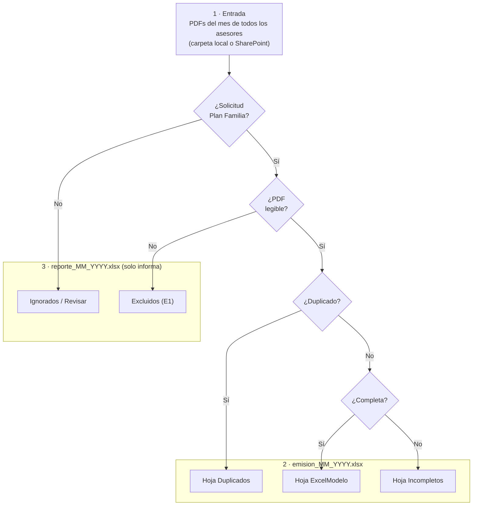

# extraccion-pdf-editables

Bot en Python que lee las **solicitudes de seguro Plan Familia** (PDF con campos editables) de todos los asesores y arma, una vez por mes:

- **`emision_MM_YYYY.xlsx`**: el Excel para la emisión masiva, con el formato del Centro Emisor.
- **`reporte_MM_YYYY.xlsx`**: un resumen de la corrida, con lo que entró, lo que faltó y lo que se descartó.

Se puede correr como script de Python o como `.exe`, y programar para que corra solo cada mes.

> No lee escaneos ni PDF en papel: solo PDF con campos de formulario completados.

## Índice

- [Cómo funciona](#cómo-funciona)
- [Primeros pasos](#primeros-pasos)
- [Dónde van los PDF](#dónde-van-los-pdf)
- [Qué genera](#qué-genera)
- [Configuración básica](#configuración-básica)
- [Tests](#tests)
- [Más documentación](#más-documentación)

---

## Cómo funciona



1. **Entrada:** el bot busca la carpeta del mes de cada asesor.
2. **Excel de emisión:** cada solicitud leída va a una de tres hojas:
   - **ExcelModelo:** tiene todos los datos obligatorios. Es la única hoja que se carga en el Centro Emisor.
   - **Incompletos:** le falta algún dato, por ejemplo el productor o el plan.
   - **Duplicados:** hay dos PDF del mismo mes, asesor y DNI. Alguien tiene que elegir cuál vale.
3. **Reporte:** cuenta todo lo que pasó en la corrida y lista lo que no entró al Excel (adjuntos, escaneos, PDF ilegibles).

---

## Primeros pasos

Necesitás Windows 10/11 y Python 3.11 o más nuevo.

**1. Instalar**

```powershell
git clone https://github.com/solanodezuasnabar-pi/extraccion-pdf-editables.git
cd extraccion-pdf-editables
python -m venv .venv
.venv\Scripts\pip install -r requirements.txt
copy configs\.env.example configs\.dev.env
```

El archivo `configs\.dev.env` ya funciona para una prueba local: SharePoint y mails quedan apagados.

**2. Poner los PDF**

Copiá las solicitudes en la carpeta del mes de cada asesor, por ejemplo:

```
SOLICITUDES SALUD VAVI-RETIRO\ASESOR 1 - SUCURSAL\SOLICITUDES ESCANEADAS\001 VTAS ENERO 26\
```

**3. Correr**

```powershell
python main.py --env dev --mes 1 --anio 2026
```

Sin `--mes` y `--anio`, procesa el mes actual.

**4. Ver el resultado**

Abrí la carpeta `output\`. Ahí quedan `emision_01_2026.xlsx` y `reporte_01_2026.xlsx`. Empezá por la hoja **Resumen** del reporte.

---

## Dónde van los PDF

El repo trae una estructura de ejemplo con carpetas vacías:

```
SOLICITUDES SALUD VAVI-RETIRO/
├── ASESOR 1 - SUCURSAL/
│   └── SOLICITUDES ESCANEADAS/
│       └── 001 VTAS ENERO 26/      ← acá van los PDF de ese mes
├── ASESOR 2 - SUCURSAL/
│   └── ...
└── ASESOR 3 - SUCURSAL/
    └── ...
```

- **Los nombres son de ejemplo.** Podés renombrar, agregar o quitar asesores y meses.
- Lo que tiene que respetarse es el patrón `<ASESOR>/SOLICITUDES ESCANEADAS/<NNN VTAS MES AA>/`, por ejemplo `002 VTAS FEBRERO 26`. Las carpetas con otro formato se ignoran y aparecen como aviso en el reporte.
- El bot procesa **todos los asesores juntos** y genera un solo Excel y un solo reporte por mes.
- Los PDF y los Excel no se suben a git.

---

## Qué genera

| Archivo                | Para qué sirve                                                                 |
| ---------------------- | ------------------------------------------------------------------------------ |
| `emision_MM_YYYY.xlsx` | Hojas `ExcelModelo` (para emitir), `Incompletos` y `Duplicados` (para revisar) |
| `reporte_MM_YYYY.xlsx` | Resumen de la corrida, hallazgos y detalle de cada PDF                         |
| `logs/process.log`     | Log técnico, para cuando algo falla                                            |
| `output/correos/`      | Avisos de inicio y fin en HTML (no se mandan por mail salvo que se active)     |

Si `ExcelModelo` sale vacío no es un error: seguramente las solicitudes están en `Incompletos` porque les falta algún dato.

---

## Configuración básica

La configuración está en `configs/.<entorno>.env` (`dev`, `tst` o `pro`). Se crea copiando `configs/.env.example`, y esos archivos no se suben a git.

Las variables que más se usan:

| Variable         | Qué hace                                                        |
| ---------------- | --------------------------------------------------------------- |
| `INPUTS`         | Carpeta donde están los PDF                                     |
| `OUTPUTS`        | Carpeta donde quedan los Excel                                  |
| `GRAPH_ENABLED`  | `true` = lee los PDF de SharePoint y publica los Excel ahí      |
| `NOTIFY_ENABLED` | `true` = manda los avisos por mail. `false` = solo los guarda   |

Las reglas de negocio (planes, códigos, tarjetas) están en `config/parametria.yaml`. Se pueden cambiar sin tocar el código.

---

## Tests

```powershell
.venv\Scripts\python.exe -m unittest discover -s tests
```

No necesitan PDF reales ni acceso a SharePoint.

---

## Más documentación

- **[Operación](docs/operacion.md):** cómo generar el `.exe`, usar `run.bat`, programarlo con Control-M y resolver errores comunes.
- **[Referencia técnica](docs/referencia.md):** todas las opciones de línea de comandos y variables, qué escribe cada columna del Excel, las hojas del reporte, los planes soportados y los códigos de salida.
