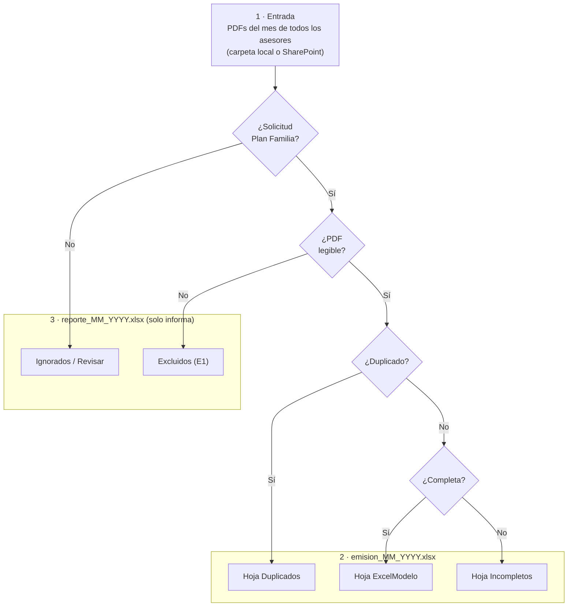

# Emisión Plan Familia VAVI (extraccion-pdf-editables)

Bot RPA local que toma **solicitudes PDF editables** (Plan Familia / Ramo 2500) y genera:

1. **Excel de Emisión** (modelo Centro Emisor, Anexo 3.3)
2. **Reporte** de la corrida (completas / incompletas / excluidos E1 / ignorados + checklist de columnas)

Arquitectura alineada al template RPA interno (`--env`, `configs/`, `process_manager`, libs). Sin Selenium. Un Excel y un reporte **por mes** (no por asesor). Graph baja el mes de la biblioteca de SharePoint y publica en `_salida/` si `GRAPH_ENABLED=true` y no hay `--repo`/`--input`. Los mails son aviso (plantillas HTML); se **guardan en disco** (`MAIL_SAVE_LOCAL`) y se envían por SMTP solo si `NOTIFY_ENABLED=true`.


|                      |                                                                        |
| -------------------- | ---------------------------------------------------------------------- |
| **Alcance**          | PDF editables · consolidado mensual · Graph opcional · script o `.exe` |
| **Fuera de alcance** | OCR de escaneos · reproceso 27–EOM · Outlook/SMTP productivo           |
| **Spec**             | Especificación Funcional V2.0 (Ramo 2500 / GSS)                        |


## Índice

- [Requisitos](#requisitos)
- [Estructura de entrada](#estructura-de-entrada)
- [Instalación (desarrollo)](#instalación-desarrollo)
  - [Tests](#tests)
- [Uso con Python](#uso-con-python)
  - [Parámetros CLI](#parámetros-cli)
- [Uso con .exe](#uso-con-exe)
  - [Generar / regenerar el ejecutable](#generar--regenerar-el-ejecutable)
  - [Operación con Control-M](#operación-con-control-m)
- [Configuración](#configuración)
- [Salidas](#salidas)
  - [Qué escribe el Excel de emisión](#qué-escribe-el-excel-de-emisión-reglas-actuales)
  - [Hojas del reporte](#hojas-del-reporte)
  - [Códigos de error](#códigos-de-error)
- [Flujo resumido](#flujo-resumido)
- [Código de salida](#código-de-salida)
- [Troubleshooting](#troubleshooting)
- [Estructura del repositorio](#estructura-del-repositorio)
- [Alcance de esta fase](#alcance-de-esta-fase)

---


## Requisitos

- Windows 10/11
- Python **3.11+** (solo para desarrollo / build)
- PDFs con **campos de formulario** (variantes *PLAN FAMILIA – PLAN 4* o *PLAN FAMILIA – ASESORES*)
- Estructura de carpetas tipo SharePoint (ver más abajo); el repo incluye la estructura vacía de ejemplo en la raíz

---


## Estructura de entrada

En la **raíz del repo** (también es el default de `INPUTS` / `run.bat`):

```
extraccion-pdf-editables/
├── SOLICITUDES SALUD VAVI-RETIRO/   # estructura de ejemplo (solo carpetas vacías con .gitkeep)
│   ├── ASESOR 1 - SUCURSAL/
│   │   └── SOLICITUDES ESCANEADAS/
│   │       └── 001 VTAS ENERO 26/         # formato <NNN VTAS MES AA>
│   │           └── *.pdf                  # acá van las solicitudes; el bot no escribe acá
│   ├── ASESOR 2 - SUCURSAL/
│   │   └── SOLICITUDES ESCANEADAS/
│   │       └── 001 VTAS ENERO 26/
│   └── ASESOR 3 - SUCURSAL/
│       └── SOLICITUDES ESCANEADAS/
│           └── 001 VTAS ENERO 26/
├── output/                          # emision_MM_YYYY.xlsx + reporte_MM_YYYY.xlsx
├── main.py
└── ...
```

> **La estructura es un ejemplo.** Los nombres de asesor (`ASESOR 1 - SUCURSAL`, etc.) y los meses son genéricos: se pueden renombrar, agregar o quitar libremente. Lo que el bot espera es el patrón `<raíz>/<ASESOR>/SOLICITUDES ESCANEADAS/<NNN VTAS MES AA>/*.pdf`, que replica la biblioteca de SharePoint. El repo no incluye PDF ni Excel de corridas: los datos de entrada no se versionan (`.gitignore`).

El bot procesa **todos los asesores** de esa carpeta para el mes indicado y deja **un** Excel + **un** reporte en `output/` (junto al `.exe` si corre empaquetado). Con Graph, **ambos** (`emision_MM_YYYY.xlsx` y `reporte_MM_YYYY.xlsx`) se publican en `GRAPH_SALIDA` (default `_salida/` bajo la raíz VAVI). `GRAPH_PUBLICAR_TODO_EN_SALIDA=false` restaura el split viejo (emisión en la raíz VAVI).

Sin `--mes`/`--anio`, usa el **mes en curso por calendario** (corrida típica día 26). Si ningún asesor tiene carpeta canónica de ese mes → error y exit `1`.

**Formato canónico de carpeta mensual:** `NNN VTAS MES AA` (ej. `002 VTAS FEBRERO 26`). Variantes como `VTAS FEBRERO 2026` o `07 julio 25` se ignoran para procesar y aparecen como aviso en log/reporte.

Si la carpeta `SOLICITUDES SALUD VAVI-RETIRO` existe junto a `run.bat` y `GRAPH_ENABLED` no es `true`, `run.bat` la usa como entrada local (eso apaga Graph). En TST/PRO, sin esa carpeta y sin `--repo`, corre Graph. Si `GRAPH_CERT_PATH` está vacío, el `.exe` pide el token al **store de Windows** (`scripts/graph_token_windows.ps1` embebido). Si hay PEM, usá esa ruta.

Para un corpus completo local (fuera del git) pasalo con `--repo` o `EMISION_REPO`. `--repo` / `--input` **apagan Graph**.

---


## Instalación (desarrollo)

```powershell
cd extraccion-pdf-editables   # raíz del clone
python -m venv .venv
.venv\Scripts\pip install -r requirements.txt
copy configs\.env.example configs\.dev.env   # y completar valores
```

Los archivos `configs/.dev.env`, `.tst.env` y `.pro.env` **no se versionan**. Se crean a partir de `configs/.env.example`.

`main.py` reutiliza el `.venv` local automáticamente si existe.

### Tests

```powershell
.venv\Scripts\python.exe -m unittest discover -s tests
```

Usan PDFs y carpetas sintéticas que se crean en temporales; no necesitan `.env` ni acceso a SharePoint. Los dos tests de regresión de `test_formularios_parametria.py` se saltean si no hay PDFs reales en `output/editables_02_2026`.

---


## Uso con Python

```powershell
cd extraccion-pdf-editables

# Mes en curso por calendario (INPUTS del .env; Graph si GRAPH_ENABLED=true)
python main.py --env dev

# Carpeta de entrada local (apaga Graph)
python main.py --env pro --repo ".\SOLICITUDES SALUD VAVI-RETIRO"

# Mes / año explícitos
python main.py --env dev --mes 2 --anio 2026

# Repo de solicitudes distinto al de INPUTS (corpus completo fuera del git)
python main.py --env dev --mes 5 --anio 2026 --repo "..\SOLICITUDES SALUD VAVI-RETIRO_FULL"

# Carpeta puntual de un mes (modo legacy)
python main.py --env dev --input "C:\ruta\a\09 VTAS SEPTIEMBRE 25" --recursive
```


### Parámetros CLI


| Parámetro          | Descripción                                                             |
| ------------------ | ----------------------------------------------------------------------- |
| `--env`            | Entorno de config: `dev`, `tst`, `pro` (default: `dev`)                 |
| `--mes` / `--anio` | Período a procesar (van juntos). Sin ellos: mes en curso por calendario |
| `--repo`           | Raíz multi-asesor (override de `INPUTS`; **apaga Graph**)               |
| `--input`          | Carpeta puntual de PDFs (modo legacy; **apaga Graph**)                  |
| `--output-dir`     | Destino de `emision_` / `reporte_` (default: `OUTPUTS`)                 |
| `--recursive`      | Buscar PDFs en subcarpetas (modo `--input`)                             |
| `--excel-asesor`   | Cruce opcional con Excel de ventas del asesor                           |
| `--sin-filtro`     | Procesar todos los PDF sin selector (no recomendado)                    |


---


## Uso con `.exe`

Forma recomendada: `run.bat` desde la raíz del proyecto (no hace falta entrar a `dist\`).

```powershell
cd extraccion-pdf-editables

# Mes en curso por calendario (carpeta de entrada local si existe junto al bat)
.\run.bat

# Mes / año explícitos (smoke típico)
.\run.bat --mes 2 --anio 2026

# TST: configs/.tst.env (Graph según GRAPH_ENABLED de ese archivo)
.\run.bat --env tst --mes 2 --anio 2026

# Graph: sin --repo. En el clone, además setear GRAPH_ENABLED=true
# para que run.bat no use la carpeta de entrada local.
$env:GRAPH_ENABLED = "true"
.\run.bat --env tst --mes 2 --anio 2026
```

Qué hace `run.bat`:

1. Busca `dist\EmisionPlanFamiliaVAVI\EmisionPlanFamiliaVAVI.exe`
2. Si el bat está en una carpeta de red (`\\servidor\...` o unidad mapeada), copia el programa a un disco local y lo ejecuta desde ahí. En disco local lo ejecuta en el lugar. Detalle en [Operación con Control-M](#operación-con-control-m), punto 2
3. Pasa `--env pro` (o `EMISION_ENV`, o el `--env` que ya vaya en la línea)
4. Pasa `--repo` **solo** si hay `EMISION_REPO`, o si existe `SOLICITUDES SALUD VAVI-RETIRO` junto al bat **y** `GRAPH_ENABLED` no es `true`
5. Reenvía el resto (`--mes`, `--anio`, `--sin-filtro`, `--repo` explícito, etc.)
6. Termina con el código de salida del `.exe`

`--repo` / `--input` fuerzan modo local y **apagan Graph**. En TST/PRO, si no hay carpeta de entrada local junto al bat, `run.bat` no inyecta `--repo`: Graph corre si `GRAPH_ENABLED=true` en el `.env`.

Por qué no hay un `.exe` suelto en la raíz: el build es **onedir** (carpeta). El ejecutable necesita `_internal\` al lado con las DLLs; solo el `.exe` no alcanza. `run.bat` evita esa fricción. El `.exe` **no se versiona** (está en `.gitignore`); cada máquina lo genera.

**Working directory del** `.exe`**:** al correr empaquetado, el proceso usa `dist\EmisionPlanFamiliaVAVI\` como cwd. Excel y reporte van a `output\` de esa carpeta (o a `_salida/` en SharePoint si Graph). Logs y mails HTML: `logs/`, `output/correos/`. Si `run.bat` se lanzó desde una carpeta de red, el proceso corre en la copia local y al terminar `run.bat` devuelve `logs\` y `output\` a `dist\EmisionPlanFamiliaVAVI\` de la carpeta de red.

### Generar / regenerar el ejecutable

```powershell
cd extraccion-pdf-editables
.venv\Scripts\pip install -r requirements.txt
.venv\Scripts\pyinstaller.exe --clean -y main.spec
```

Salida: `dist\EmisionPlanFamiliaVAVI\` (`.exe` + `_internal`). Recursos embebidos: `parametria.yaml`, template CE, configs, plantillas de correo.

Después de cambiar código, regenerá el `.exe` y seguí usando `.\run.bat` igual.

Smoke mínimo post-build:

```powershell
.\run.bat --mes 1 --anio 2026    # mes explícito (con PDFs en la carpeta de entrada)
.\run.bat                        # mes en curso por calendario
```

Verificá exit code `0` (si hubo incompletas o completas), `emision_MM_YYYY.xlsx` + `reporte_MM_YYYY.xlsx` en `dist\EmisionPlanFamiliaVAVI\output\` (o en `output\` si corriste con Python) y mails en `dist\EmisionPlanFamiliaVAVI\output\correos\`. **No** busques el Excel dentro de la carpeta del asesor.

### Operación con Control-M

Esta sección es para **IT**: cómo dejar el bot instalado y qué tiene que disparar Control-M. El job lo arman ellos; acá está el instructivo.

**1. Fecha y hora**

Día **26** de cada mes, **13:00** hora Argentina. El bot procesa el mes que está en el calendario (en septiembre, septiembre). No hace falta indicarle el mes ni el año a traves de "`--mes --anio`".

**2. Carpeta en el servidor**

Va en `PRO` (igual que TST, otra carpeta):

```
\\<servidor>\<carpeta-del-bot>\PRO\
  run.bat
  dist\EmisionPlanFamiliaVAVI\
    EmisionPlanFamiliaVAVI.exe
    _internal\
    configs\.pro.env
```

Hay que copiar **toda** la carpeta `EmisionPlanFamiliaVAVI` (el `.exe` y `_internal` juntos). El `.exe` solo no funciona.

Usá el mismo programa que ya se probó en TST. No generes un `.exe` nuevo el día 26.

No pongas la carpeta de entrada local `SOLICITUDES SALUD VAVI-RETIRO` al lado de `run.bat`. Si está, el bot no usa SharePoint.

**Ejecución desde la carpeta de red**

`run.bat` se llama directo por su ruta de red. No hace falta mapear una unidad ni hacer `cd`:

```bat
\\<servidor>\<carpeta-del-bot>\PRO\run.bat --env pro
```

Cuando está en una carpeta de red (`\\servidor\...` o unidad mapeada), `run.bat`:

1. Copia `dist\EmisionPlanFamiliaVAVI\` a un disco local: `%LOCALAPPDATA%\EmisionPlanFamiliaVAVI\<carpeta del bat>` (para PRO, `...\EmisionPlanFamiliaVAVI\PRO`). La primera vez copia todo (unos 85 MB); después, solo lo que cambió.
2. Ejecuta el `.exe` desde esa copia local.
3. Devuelve `logs\` y `output\` a `dist\EmisionPlanFamiliaVAVI\` de la carpeta de red.
4. Termina con el código de salida del bot.

Motivo: el `.exe` ejecutado directo desde la carpeta de red no resuelve DNS (`getaddrinfo failed`, error 11003) y no llega a SharePoint ni al SMTP. Verificado en pruebas: el mismo `.exe` falla desde la red y funciona desde disco local.

Qué necesita la cuenta del job:

- Escritura en la carpeta local. Para usar otra en lugar de `%LOCALAPPDATA%`, definí la variable de entorno `EMISION_LOCAL_DIR` en el job (por ejemplo `C:\RPA`). El programa queda en `<esa carpeta>\EmisionPlanFamiliaVAVI\<carpeta del bat>`.
- Escritura en `dist\EmisionPlanFamiliaVAVI\logs` y `output` de la carpeta de red. Si falla, el bot igual corre y publica en SharePoint; `run.bat` lo avisa y el log queda solo en la copia local hasta la corrida siguiente.

La configuración se edita siempre en la carpeta de red (`configs\.pro.env`). La copia local se pisa en cada corrida; no la edites.

Si `run.bat` está en un disco local, ejecuta el `.exe` en el lugar, sin copiar nada.

**3. Comando del job**

```bat
run.bat --env pro
```

Eso es todo. No agregues `--mes`, `--anio`, ni una carpeta de solicitudes.

Si en lugar del `.bat` llaman al `.exe`, tienen que:

- escribir `--env pro` (si no, corre como desarrollo, no como producción);
- ejecutarlo desde `dist\EmisionPlanFamiliaVAVI\`;
- tenerlo en un disco local. El `.exe` de la carpeta de red no resuelve DNS: desde la red usen siempre `run.bat`.

**4. Archivo de configuración** (`configs\.pro.env`, al lado del `.exe`)

Se puede editar en el servidor; no hace falta que coincida con git.


| Variable          | Valor                     | Para qué                                                               |
| ----------------- | ------------------------- | ---------------------------------------------------------------------- |
| `GRAPH_ENABLED`   | `true`                    | Lee y publica en SharePoint                                            |
| `NOTIFY_ENABLED`  | `false`                   | No manda mails (hasta que IT tenga SMTP)                               |
| `MAIL_SAVE_LOCAL` | `true`                    | Guarda el aviso HTML en disco                                          |
| `GRAPH_CERT_PATH` | vacío, o ruta a un `.pem` | Vacío = usa el certificado instalado en Windows, con la cuenta del job |
| `GRAPH_SALIDA`    | `_salida`                 | Carpeta de SharePoint donde quedan los dos Excel                       |


La cuenta de Windows con la que corre Control-M tiene que tener acceso a ese certificado (el mismo de TST).

**5. Cómo se ve una corrida buena**


| Qué                                       | Dónde                                                           |
| ----------------------------------------- | --------------------------------------------------------------- |
| Excel de emisión (`emision_MM_YYYY.xlsx`) | SharePoint → Solicitudes Salud VAVI-Retiro → carpeta `_salida`  |
| Reporte (`reporte_MM_YYYY.xlsx`)          | La misma carpeta `_salida`                                      |
| Log                                       | `logs\process.log`, al lado del `.exe`                          |
| Aviso de correo (HTML)                    | `output\correos\`, al lado del `.exe`. **No** se envía por mail |


Si alguien tiene el Excel abierto en SharePoint, el bot igual termina y lo anota en el log. Control-M puede figurar en verde y el archivo no estar en `_salida`: en ese caso hay que abrir el log.

**6. Si** `ExcelModelo` **viene vacío**

Es normal mientras falte productor u organizador: esas propuestas están en la hoja **Incompletos**. Si hay dos PDF del mismo período, asesor y DNI, las dos versiones están en la hoja **Duplicados** y Suscripción elige cuál vale. **No es un fallo.** El bot devuelve código `0` y Control-M puede quedar en verde. Quien valida el mes mira esas hojas, no el color del job.

**7. Códigos de Control-M**


| Código | Qué significa                                                                                  |
| ------ | ---------------------------------------------------------------------------------------------- |
| `0`    | Terminó bien. Puede haber filas para emitir, incompletas, o las dos.                           |
| `1`    | No pudo arrancar (configuración) o no encontró la carpeta del mes (`001 VTAS ENERO 26`, etc.). |
| `2`    | Le pasaron mes sin año, o al revés. El job no tiene que enviar eso.                            |


---


## Configuración

Archivos en `configs/`:


| Archivo        | Uso                                       |
| -------------- | ----------------------------------------- |
| `.env.example` | Plantilla versionada con todas las claves |
| `.dev.env`     | Desarrollo (no versionado)                |
| `.tst.env`     | Pruebas (no versionado)                   |
| `.pro.env`     | Productivo (no versionado)                |


Variables relevantes:


| Variable                          | Significado                                                                      |
| --------------------------------- | -------------------------------------------------------------------------------- |
| `INPUTS`                          | Repo multi-asesor local (si Graph está apagado y no hay `--repo`)                |
| `OUTPUTS`                         | Destino de `emision_` / `reporte_` y base de `output/correos/`                   |
| `LOGS`                            | Carpeta de `process.log`                                                         |
| `TEMPLATES`                       | Carpeta del template Excel CE (`Modelo salud CE.xlsx`)                           |
| `MAIL_TEMPLATES`                  | Carpeta `Plantillas/` (HTML de inicio, fin OK y error)                           |
| `NOTIFY_ENABLED`                  | `true` = envía los avisos por SMTP. `false` = solo los guarda en disco.          |
| `MAIL_SAVE_LOCAL`                 | Guarda HTML renderizado en `output/correos/<timestamp>/`                         |
| `GRAPH_ENABLED`                   | `true` = baja el mes de SharePoint y publica emisión + reporte en `GRAPH_SALIDA`. |
| `GRAPH_CERT_PATH`                 | PEM del certificado. **Vacío** = store de Windows (`.exe` y scripts de probe).   |
| `GRAPH_THUMBPRINT`                | Thumbprint del certificado                                                       |
| `GRAPH_TENANT_ID` / `GRAPH_CLIENT_ID` | Tenant de Azure AD y app registrada (app-only)                           |
| `GRAPH_SITE_ID` / `GRAPH_LIST_ID` | Sitio de SharePoint + biblioteca donde está la raíz VAVI                         |
| `GRAPH_VAVI_ROOT`                 | Carpeta raíz VAVI (default `SOLICITUDES SALUD VAVI-RETIRO`)                      |
| `GRAPH_SALIDA`                    | Destino de **emisión y reporte** (default `_salida`).                            |
| `GRAPH_PUBLICAR_TODO_EN_SALIDA`   | Default `true`. `false` = emisión en la raíz VAVI (split viejo).                 |
| `EXCEL_ASESOR_PREFERIDO`          | Opcional. Sin `--excel-asesor`, elige el `VENTAS SALUD ASESORES*.xlsx` cuyo nombre contenga este texto; si no hay, el primero alfabético. |


- Si `MAIL_SAVE_LOCAL=true`, cada corrida guarda `01_inicio.html`, `02_fin_ok.html` o `02_error.html` y `asuntos.txt`.
- Si `NOTIFY_ENABLED=true`, además envía mails de inicio, fin y error por SMTP. El Excel no va adjunto.
- `PROCESS_SUCCESS_EMAILS` y `PROCESS_ERROR_EMAILS` tienen que ser casillas del dominio corporativo que acepta el relay SMTP. Otros dominios pueden no entregarse.
- Si SMTP no responde, el lote continúa y el incidente queda en `logs/process.log`.

Muestras estáticas para el cliente (sin correr el lote):

```powershell
.venv\Scripts\python.exe scripts\preview_mail_templates.py
# → output\muestras_correo\
```

Parametría de negocio: `config/parametria.yaml`.


| Sección                             | Qué controla                                                                          |
| ----------------------------------- | ------------------------------------------------------------------------------------- |
| `opcion_cobertura_por_plan`         | Plan → código CE (`OPCION_COBERTURA`)                                                 |
| `grupo_estadistico` / `pais_origen` | Valores fijos del Excel                                                               |
| `tarjetas`                          | Nombre de tarjeta → código CE                                                         |
| `formularios.modulo_excel`          | Etiqueta A/B → valor Excel `MODULO` (1/2)                                             |
| `formularios.variantes`             | Lectura de plan/módulo por variante PDF (`plan4`, `asesores`: campos y export values) |


> En YAML, las claves de export `On` **/** `Off` **deben ir entre comillas** (`"On": "5"`). Sin comillas, PyYAML las interpreta como booleanos.

Cambiar plan/módulo o sumar un export nuevo: editar el YAML (y regenerar el `.exe` si entregás empaquetado). No hace falta tocar el extractor.

Template CE: `templates/Modelo salud CE.xlsx`.

---


## Salidas

Un par de archivos **por mes**, no por asesor. Destino local: `output/` (junto al script o al `.exe`). Con Graph, además se publican en `GRAPH_SALIDA` (`_salida/` por defecto).


| Archivo                | Contenido                                                          |
| ---------------------- | ------------------------------------------------------------------ |
| `emision_MM_YYYY.xlsx` | Todas las propuestas del mes: `ExcelModelo` + `Incompletos` + `Duplicados` |
| `reporte_MM_YYYY.xlsx` | Trazabilidad consolidada (incluye columnas Asesor / Ruta)          |
| `logs/process.log`     | Log técnico (junto al working dir)                                 |
| `output/correos/`      | Mails HTML de aviso (si `MAIL_SAVE_LOCAL=true`); no adjuntan Excel |


### Qué escribe el Excel de emisión (reglas actuales)

Alineado al patrón `ExcelModelo` del CE (Anexo 3.3):


| Tema                              | Comportamiento                                                                                                              |
| --------------------------------- | --------------------------------------------------------------------------------------------------------------------------- |
| Filas                             | Una fila **Titular** (tomador) + una por cada asegurable (**Asegurado Titular** / **Asegurado Familiar**)                   |
| Nombre / email                    | Se repiten en Titular y asegurados (como operativa CE / Hoja1)                                                              |
| Pago (`CBU` / tarjeta / efectivo) | Solo en la fila **Titular**. CBU 22 dígitos o tarjeta 13–19 + marca conocida se copian; si falta o está mal → `EFECTIVO=1`. |
| `OPCION_COBERTURA`                | En todas las filas (según plan 4/5/6/100 → parametría)                                                                      |
| `ORGANIZADOR` / `PRODUCTOR`       | Solo si el PDF trae el número; si no, vacío (no se inventa)                                                                 |
| `SEXO`                            | Solo si el PDF trae el campo (`M`/`F`); Plan Familia suele no tenerlo → vacío                                               |
| `PROPUESTA`                       | Solo fila **Titular**: `VAVI` + fecha del run (`yyyymmdd`) + 4 dígitos (`fila Excel + 23`). Familiares vacío.               |
| Vigencia                          | Si el PDF trae inicio y fin, se usan. Si trae solo el inicio, el fin es un año después. Si no trae ninguna, el inicio es el día 1 del mes siguiente a la carpeta de ventas y el fin es esa fecha al año siguiente (noviembre 2026 → 01/12/2026–01/12/2027). |
| Hojas                             | `ExcelModelo` (completas), `Incompletos` (faltantes) y `Duplicados` (las dos versiones; misma grilla). La hoja `Duplicados` se crea igual, vacía si no hay casos. El CE emite solo `ExcelModelo`. |


DNI, opción, organizador, etc. se escriben como **texto** en el Excel (formato `@`) para no perder ceros ni forzar formato numérico al importar.

### Hojas del reporte


| Hoja                   | Contenido                                                                                      |
| ---------------------- | ---------------------------------------------------------------------------------------------- |
| **Resumen**            | Veredicto, conteos, cómo usar + **glosario** (Completa / Incompleta / E1 / Ignorado / Revisar) |
| **Hallazgos**          | Lista accionable; columna **Para (Negocio / Técnico)**                                         |
| **Procesados**         | PDFs emitidos (tomador, plan, módulo, pago, etc.)                                              |
| **Incompletos**        | Propuestas con faltantes de la lista de completitud (van al Excel, hoja `Incompletos`)         |
| **Excluidos**          | E1 con motivo y acción sugerida                                                                |
| **Ignorados**          | Adjuntos u otros formularios (no Plan Familia)                                                 |
| **Revisar**            | Escaneos / casos no clasificados con claridad                                                  |
| **Cruce Excel asesor** | Solo si se usó `--excel-asesor`                                                                |
| **Validacion**         | Checklist Anexo 3.3 + columna Origen (PDF/figura/fila)                                         |


### Códigos de error y completitud


| Código / categoría | Significado                                                                                   |
| ------------------ | --------------------------------------------------------------------------------------------- |
| **E1**             | No se pudo extraer (escaneo, plantilla vacía, excepción) — **excluido** del Excel             |
| **Incompletos**    | PDF extraíble con faltantes de la **lista de completitud** — van enteras a hoja `Incompletos` |
| **Completa**       | Todos los campos de la lista presentes — hoja `ExcelModelo`                                   |


El lote **sigue** aunque haya E1 o incompletos: completas e incompletas van al Excel; E1 queda en el reporte.

---


## Flujo resumido



1. **Entrada:** el bot toma la carpeta `NNN VTAS MES AA` de cada asesor, ya sea local o descargada de SharePoint.
2. **Excel de emisión:** cada solicitud leída termina en una de sus tres hojas. Es *duplicado* cuando hay dos PDF del mismo mes, asesor y DNI; *completa*, cuando tiene todos los datos obligatorios. Solo `ExcelModelo` se carga en el Centro Emisor.
3. **Reporte:** resume la corrida completa y lista lo que no entró al Excel (adjuntos, escaneos, PDF ilegibles).

Los dos archivos se guardan en `output/` o, si corre con Graph, en `_salida/` de SharePoint.

Detalle técnico:

```
Repo local o Graph (staging) + mes/año
        → Snapshot inmutable del lote
        → Selector (solicitud Plan Familia vs adjunto / otro form)
        → Extracción N1 (campos PDF)
        → Normalización (vigencia por PDF o por mes de carpeta; pago)
        → Lista de completitud (completa → ExcelModelo; incompleta → Incompletos)
        → Duplicados ambiguos (mismo período + asesor + DNI) → hoja Duplicados; no van a ExcelModelo ni a Incompletos
        → Un Excel CE + un reporte en output/; con Graph: ambos en _salida/
```

Planes soportados (Anexo 3.5):


| Formulario              | Plan | `OPCION_COBERTURA` |
| ----------------------- | ---- | ------------------ |
| PLAN FAMILIA – PLAN 4   | 4    | 18484              |
| PLAN FAMILIA – ASESORES | 5    | 28275              |
| PLAN FAMILIA – ASESORES | 6    | 33403              |
| PLAN FAMILIA – ASESORES | 100  | 56128              |


“ASESORES” es la **variante del PDF**, no un plan. Si en ese form no marcan Plan 5/6/100 ni módulo A/B → **Incompletos** (faltante de módulo/plan en la lista de completitud).

---


## Código de salida


| Código | Significado                                                                                                                                                      |
| ------ | ---------------------------------------------------------------------------------------------------------------------------------------------------------------- |
| `0`    | El lote corrió. En Graph/repo: completas **o** incompletas **o** E1/ignorados/revisar/ítems. `ExcelModelo` vacío con filas en `Incompletos` = `0` (no es error). |
| `1`    | Config, excepción, o sin carpeta canónica del mes (snapshot vacío de verdad).                                                                                    |
| `2`    | CLI inválida (ej. `--mes` sin `--anio`)                                                                                                                          |


El job Control-M no pasa `--mes`/`--anio`. Tratar **exit 0 = el proceso corrió**. Detalle de negocio: hoja `Incompletos` / reporte, no el color del job. Ver [Operación con Control-M](#operación-con-control-m).

---


## Troubleshooting


| Problema                                                    | Qué hacer                                                                                                                                                                                               |
| ----------------------------------------------------------- | ------------------------------------------------------------------------------------------------------------------------------------------------------------------------------------------------------- |
| `El término '.\EmisionPlanFamiliaVAVI.exe' no se reconoce`  | No está en la raíz: usá `.\run.bat`                                                                                                                                                                     |
| `CMD no es compatible con las rutas UNC`                    | No hagas `cd` a `\\servidor\...`. Llamá a `run.bat` por su ruta completa (`\\servidor\...\TST\run.bat`); no hace falta mapear una unidad.                                                                   |
| `getaddrinfo failed` / error 11003 (no resuelve DNS)        | Se ejecutó el `.exe` directo desde la carpeta de red. Usá `run.bat`, que lo copia a disco local y lo corre desde ahí.                                                                                   |
| `no se pudo copiar el programa` / `ya existe y no es una copia de este programa` (mensajes de `run.bat`) | La cuenta no puede escribir en la carpeta local, o esa carpeta tiene otra cosa. Definí `EMISION_LOCAL_DIR` con una carpeta local donde la cuenta pueda escribir. |
| `No se encontro el .exe` (mensaje de `run.bat`)             | Generarlo: `.venv\Scripts\python.exe -m PyInstaller --clean -y main.spec`                                                                                                                               |
| `No existe el repo indicado (--repo)`                       | Ruta inválida. Sin `--repo`, `run.bat` usa la carpeta de entrada local si existe.                                                                                                                                   |
| Graph no corre / no baja de SharePoint                      | Sacá `--repo`/`--input`. `GRAPH_ENABLED=true`. `GRAPH_CERT_PATH` vacío usa el store de Windows; si hay PEM, esa ruta. En el clone, `set GRAPH_ENABLED=true` para que `run.bat` no inyecte el set local. |
| Token store Windows no responde (timeout 60s)               | El `.ps1` del certificado se colgó. Revisá el cert en el store de la cuenta del job, o usá PEM en `GRAPH_CERT_PATH`. Control-M debe ver exit 1, no un job eterno. |
| El mail no llega                                            | El destinatario tiene que ser del dominio corporativo que acepta el relay (`PROCESS_SUCCESS_EMAILS` / `PROCESS_ERROR_EMAILS`). |
| `No existe la carpeta de entrada` / fallback a `documentos` | Falló `--repo` / `INPUTS`; corregí la ruta del repo de solicitudes                                                                                                                                      |
| `PermissionError` al guardar Excel                          | Cerrá el `.xlsx` si está abierto en Excel                                                                                                                                                               |
| `Selector → procesar: 0`                                    | Los PDF no son Plan Familia (u son adjuntos); mirá hoja **Ignorados**                                                                                                                                   |
| Incompletos plan / módulo                                   | En el PDF no están marcados TIPO PLAN / COBERTURA (A/B) — van a hoja `Incompletos`                                                                                                                      |


Tras cambiar código, regenerá el `.exe` con `pyinstaller main.spec` (el binario no se actualiza solo).

---


## Estructura del repositorio

```
extraccion-pdf-editables/   # raíz del clone (= este README)
├── run.bat
├── main.py
├── main.spec
├── requirements.txt
├── .gitignore
├── configs/                # .env.example (los .env reales no se versionan)
├── config/parametria.yaml
├── templates/              # Modelo salud CE.xlsx
├── Plantillas/             # plantillas de correo (repo)
├── src/
├── scripts/
├── tests/
├── SOLICITUDES SALUD VAVI-RETIRO/  # estructura de entrada de ejemplo (vacía)
├── dist/                   # NO versionado — build local del .exe
├── logs/                   # NO versionado
└── output/                 # NO versionado
```

---


## Alcance de esta fase

- ✅ PDF editables → Excel Anexo 3.3 + reporte
- ✅ Un Excel + un reporte consolidados del mes
- ✅ Conector Graph (`GRAPH_ENABLED=true`; emisión y reporte en `_salida/`)
- ✅ Empaquetado `.exe` (CLI)
- ❌ OCR / escaneos manuscritos
- ❌ Reproceso 27–fin de mes (Etapa 5, Negocio)
- ❌ SMTP productivo (IT del cliente; `NOTIFY_ENABLED=false` en el job)
- Control-M: contrato en [Operación con Control-M](#operación-con-control-m); el job lo arma IT

